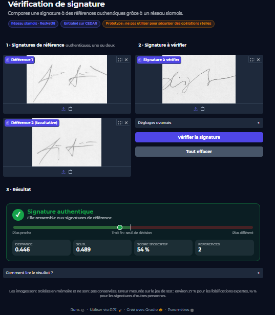
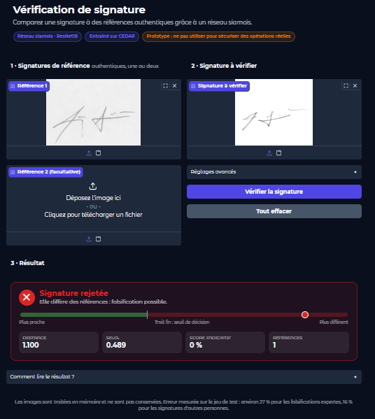
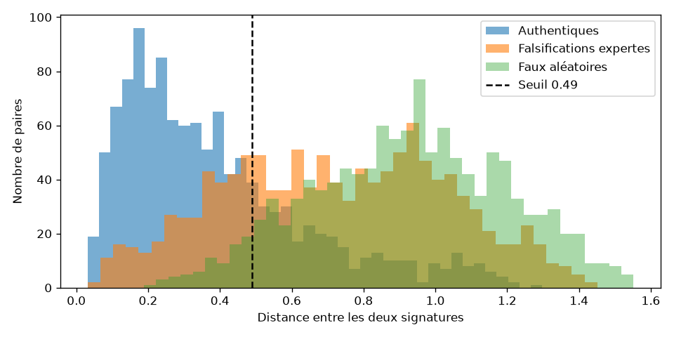

# Vérification de signature manuscrite par réseau siamois

Système qui détermine si une signature est **authentique** en la comparant à une ou plusieurs signatures de référence de la même personne. Il repose sur un réseau siamois (ResNet18 pré-entraîné) entraîné sur le jeu de données CEDAR, avec une démo Gradio et une API FastAPI.

> **Statut : prototype de démonstration.** Les performances mesurées (voir [Résultats](#résultats)) ne permettent pas de sécuriser des opérations réelles (paiements, contrats, accès). Les limites sont détaillées plus bas.

 
 

---

## Sommaire

1. [Contexte et cas d'usage](#contexte-et-cas-dusage)
2. [Données](#données)
3. [Méthode](#méthode)
4. [Résultats](#résultats)
5. [Limites](#limites)
6. [Structure du dépôt](#structure-du-dépôt)
7. [Installation](#installation)
8. [Utilisation](#utilisation)
9. [Pistes d'amélioration](#pistes-damélioration)
10. [Éthique et confidentialité](#éthique-et-confidentialité)
11. [Références](#références)

---

## Contexte et cas d'usage

La vérification de signature intervient partout où un document doit être validé par une personne : ouverture de compte en banque ou en microfinance, chèques, contrats, procurations, démarches administratives. Aujourd'hui, la comparaison est souvent faite à l'œil, ce qui est lent et variable d'un agent à l'autre.

Ce projet traite la **vérification hors ligne** (*offline*) : on dispose seulement d'une **image** de la signature (scan ou photo), sans information sur la dynamique du tracé (vitesse, pression).

Deux tâches sont distinguées en biométrie :

| Tâche | Question | Ce projet |
|---|---|---|
| **Vérification** | Cette signature est-elle bien celle de la personne annoncée ? | ✅ |
| Identification | À qui appartient cette signature ? | ❌ |

**Principe de fonctionnement :** le système ne reconnaît pas des personnes connues d'avance. Il mesure la **distance** entre la signature à vérifier et les signatures de référence. Si cette distance est inférieure à un seuil, la signature est acceptée. Il peut donc être utilisé pour de nouvelles personnes sans réentraînement : il suffit de disposer de leurs signatures de référence.

---

## Données

**Jeu de données : CEDAR** (Center of Excellence for Document Analysis and Recognition, université de Buffalo).

| | |
|---|---|
| Signataires | 55 |
| Signatures authentiques par personne | 24 |
| Falsifications par personne | 24 |
| Total | 2 640 images, scannées à 300 dpi, en niveaux de gris |

- Page du projet : <https://cedar.buffalo.edu/NIJ/projectinfo.html>
- Version Kaggle utilisée : <https://www.kaggle.com/datasets/shreelakshmigp/cedardataset>

Les données ne sont **pas incluses dans ce dépôt**. Vérifiez les conditions d'utilisation avant tout usage autre que pédagogique ou de recherche.

**Organisation attendue :**

```
data/raw/full_org/original_<personne>_<n>.png     # signatures authentiques
data/raw/full_forg/forgeries_<personne>_<n>.png   # falsifications
```

**Séparation train / validation / test : par personne.** Les 55 signataires sont répartis en 39 pour l'entraînement, 8 pour la validation et 8 pour le test (graine fixe, résultat reproductible). Une personne n'apparaît jamais dans deux ensembles : le modèle est donc évalué sur des gens qu'il n'a jamais vus, comme en situation réelle.

---

## Méthode

### 1. Prétraitement (`src/preprocessing.py`)

Chaque image passe par la même chaîne, pour que les signatures soient comparables quelle que soit leur origine :

1. réduction des très grandes images (photos de téléphone) ;
2. conversion en niveaux de gris et léger flou ;
3. **normalisation de l'éclairage** : estimation puis suppression du fond, pour que les ombres ne soient pas prises pour de l'encre ;
4. binarisation d'Otsu (encre = blanc, fond = noir) et suppression des petites taches ;
5. recadrage autour de la signature ;
6. redimensionnement à **155 × 220** en conservant les proportions, avec centrage ;
7. normalisation des pixels entre 0 et 1.

L'étape 3 a été ajoutée après un test sur des photos personnelles : sans elle, une ombre sur la feuille devenait un bloc blanc qui écrasait la signature. Sur les scans propres de CEDAR, le résultat est identique à la version précédente, et l'évaluation confirme que les performances ne changent pas.

### 2. Construction des paires (`src/dataset.py`)

Le réseau apprend à comparer deux signatures. Chaque exemple est une paire avec une étiquette :

- **1** : deux signatures authentiques de la même personne ;
- **0** : une signature authentique et une falsification de la même personne (environ 70 % des paires négatives), ou la signature d'une autre personne.

De nouvelles paires sont tirées à chaque époque. Pour l'entraînement, une **augmentation de données** déforme légèrement chaque image (rotation d'environ ±5°, changement d'échelle, décalage, inclinaison), car une personne ne signe jamais exactement pareil.

### 3. Modèle (`src/model.py`)

**Réseau siamois** : le même encodeur est appliqué aux deux images, avec les mêmes poids. Il transforme chaque signature en un vecteur de 128 nombres (embedding), normalisé à une norme de 1. La distance entre les deux vecteurs mesure leur dissemblance (de 0 à 2).

- **Encodeur retenu : ResNet18 pré-entraîné sur ImageNet**, affiné sur les signatures. Il connaît déjà traits, courbes et textures, ce qui compense le petit nombre de signataires (39).
- Un petit CNN entraîné de zéro est aussi disponible (`--backbone cnn`) et sert de point de comparaison.

**Fonction de perte : contrastive loss.** Elle rapproche les paires authentiques et éloigne les autres d'au moins une marge de 1,0.

### 4. Entraînement (`src/train.py`)

- Optimiseur AdamW (learning rate 1e-4 pour le ResNet, 10 fois plus pour la nouvelle tête), pénalité sur les poids de 1e-2.
- Learning rate divisé par 2 quand la perte de validation stagne.
- **Arrêt anticipé** après 8 époques sans amélioration, et sauvegarde du meilleur modèle selon la perte de validation.
- Entraînement sur GPU via Google Colab (un notebook est fourni).

### 5. Décision (`src/predict.py`)

Pour chaque signature à vérifier :

1. calcul de la distance avec chacune des signatures de référence ;
2. moyenne de ces distances (plus il y a de références, plus la décision est fiable) ;
3. **acceptée si la distance moyenne est inférieure au seuil**.

Le seuil par défaut, **0,489**, est le point où le taux de fausses acceptations égale celui de faux rejets pour les falsifications expertes sur le jeu de test. Il peut être ajusté selon le besoin (voir [Utilisation](#utilisation)).

---

## Résultats

### Métriques

- **FAR** (*False Acceptance Rate*) : part de fausses signatures acceptées ;
- **FRR** (*False Rejection Rate*) : part de vraies signatures rejetées ;
- **EER** (*Equal Error Rate*) : taux d'erreur au seuil où FAR = FRR. Plus il est bas, mieux c'est.

Deux situations sont évaluées séparément :

- **Falsifications expertes** : une personne a imité la signature (cas difficile) ;
- **Faux aléatoires** : la signature d'une autre personne (cas facile).

### Comparaison des versions

Évaluation sur les **8 personnes de test** (1 200 paires authentiques, 1 200 falsifications expertes, 1 200 faux aléatoires).

| Version | Modèle | EER falsifications expertes | EER faux aléatoires |
|---|---|---|---|
| v1 | Petit CNN entraîné de zéro | 27,2 % | 26,0 % |
| v2 | CNN + augmentation + embeddings normalisés + régularisation | 26,8 % | 22,0 % |
| **v3** | **ResNet18 pré-entraîné** | **26,9 %** | **16,2 %** |

Avec le prétraitement robuste aux photos, la version v3 donne 27,1 % et 16,3 %, soit des performances identiques sur CEDAR.

**Détail de la v3 au seuil 0,489 :** FAR = 26,8 % et FRR = 27,0 % pour les falsifications expertes. Distances moyennes : 0,387 pour les signatures authentiques, 0,722 pour les falsifications et 0,924 pour les faux aléatoires.



### Lecture des résultats

- Le passage à un réseau pré-entraîné améliore nettement le rejet des signatures d'autres personnes (26 % → 16 %).
- Il **n'améliore pas** les falsifications expertes (environ 27 % pour les trois versions) : ce n'est donc pas une question de choix de réseau.
- Le jeu de test ne compte que **8 personnes** : des écarts de un ou deux points ne sont pas significatifs, mais l'ordre de grandeur est fiable.

### Tests informels

Les cas attendus se comportent comme prévu sur CEDAR : vraie signature de la même personne acceptée, falsification rejetée, signature d'une autre personne rejetée. Des tests sur des photos personnelles (signature sur feuille blanche, photographiée au téléphone) ont aussi été réalisés, mais **ne sont pas chiffrés** et ne remplacent pas une évaluation sur un jeu de données réel.

---

## Limites

- **Falsifications expertes : environ 27 % d'erreur.** Ce niveau est insuffisant pour un usage sécuritaire. Les travaux publiés rapportent de bien meilleurs scores sur CEDAR, souvent avec des protocoles différents (par exemple plus de signatures par personne).
- **Peu de signataires** (39 pour l'entraînement) et **une seule base** : la généralisation à d'autres écritures, stylos, supports et contextes n'est pas démontrée. Le modèle n'a pas été testé sur des signatures locales.
- **Sensibilité à la qualité de l'image.** Le modèle a été entraîné sur des scans propres. Les photos fortement ombrées, floues, avec le bord de la feuille ou le texte de l'autre face visible peuvent dégrader le résultat.
- **Sensibilité à l'orientation.** Le modèle a été entraîné avec de petites rotations (environ ±5°) : une signature photographiée tournée de 90° sera probablement rejetée, même authentique. Une option de tolérance à la rotation existe (voir [Utilisation](#utilisation)), mais elle n'a **pas été évaluée** et augmente le risque d'accepter une falsification.
- **Évaluation sur 8 personnes**, donc des chiffres bruités.
- **Pas de détection de vivacité** : une photocopie ou une image d'une vraie signature serait traitée comme une signature normale.

---

## Structure du dépôt

```
signature-verification/
├── data/                       # non versionné (voir Données)
│   ├── raw/
│   └── processed/
├── notebooks/
│   ├── 01_exploration.ipynb    # exploration des données et des paires
│   └── colab_training.ipynb    # entraînement sur Google Colab
├── src/
│   ├── preprocessing.py        # prétraitement des images
│   ├── dataset.py              # séparation par personne, paires, augmentation
│   ├── model.py                # réseau siamois, contrastive loss
│   ├── train.py                # entraînement
│   ├── evaluate.py             # FAR, FRR, EER, graphique des distances
│   └── predict.py              # vérification d'une signature
├── api/
│   └── main.py                 # API FastAPI
├── app/
│   └── demo.py                 # démo Gradio
├── models/
│   ├── best_model_v3.pt        # modèle retenu (ResNet18)
│   └── distances_v3.png        # graphique des distances
├── requirements.txt
└── README.md
```

---

## Installation

Prérequis : Python 3.10 ou plus récent.

```bash
git clone https://github.com/<utilisateur>/signature-verification.git
cd signature-verification

python -m venv venv
# Windows (PowerShell) :
venv\Scripts\activate
# Linux / macOS :
source venv/bin/activate

pip install -r requirements.txt
```

Téléchargez ensuite CEDAR (voir [Données](#données)) et placez les dossiers `full_org` et `full_forg` dans `data/raw/`.

---

## Utilisation

Toutes les commandes se lancent **depuis la racine du projet**.

### Vérifier le chargement des données

```bash
python src/dataset.py
```

Doit afficher le nombre de personnes par ensemble (39 / 8 / 8) et la forme d'une paire.

### Entraîner

Sur un ordinateur sans GPU, l'entraînement est long. Le notebook `notebooks/colab_training.ipynb` automatise l'entraînement sur Google Colab (GPU gratuit). La commande équivalente :

```bash
python src/train.py --backbone resnet18 --epochs 40 --workers 2 --out models/best_model_v3.pt
```

L'ancien petit CNN s'entraîne avec `--backbone cnn`. Un test rapide : `--epochs 3 --pairs-per-person 40`.

### Évaluer

```bash
python src/evaluate.py --backbone resnet18 --model models/best_model_v3.pt --out models/distances_v3.png
```

Calcule l'EER (falsifications expertes et faux aléatoires), le seuil recommandé, le FAR et le FRR, et enregistre le graphique des distances. La valeur de `--backbone` doit correspondre au modèle chargé.

### Vérifier une signature en ligne de commande

```bash
python src/predict.py signature_a_verifier.png --reference ref1.png ref2.png
```

Les références sont des signatures **authentiques** de la personne. Plus il y en a, plus la décision est fiable.

Option `--rotation` : `off` (défaut, signatures dans le même sens), `quarter` (essaie 0°, 90°, 180°, 270°) ou `full` (24 angles, pas de 15°). Essayer plusieurs angles aide quand une photo est tournée, mais donne aussi plus de chances à une falsification de ressembler à une référence : à utiliser avec prudence.

### Démo Gradio

```bash
python app/demo.py            # en local
python app/demo.py --share    # lien public temporaire
```

Interface avec deux signatures de référence (la seconde est facultative), la signature à vérifier et une carte de résultat (verdict, position de la distance par rapport au seuil, score indicatif). Les réglages avancés donnent accès au seuil et à la tolérance à la rotation. Plus le seuil est bas, plus le système est strict : il rejette davantage de fausses signatures, mais aussi davantage de vraies.

### API

```bash
uvicorn api.main:app --reload
```

Documentation interactive : <http://127.0.0.1:8000/docs> (chaque signature se charge dans son propre champ : `candidate`, `reference_1`, et en option `reference_2` et `reference_3`).

```bash
curl -X POST http://127.0.0.1:8000/verify \
  -F "candidate=@a_verifier.png" \
  -F "reference_1=@ref1.png" \
  -F "reference_2=@ref2.png"
```

Champs facultatifs : `rotation` (`off`, `quarter` ou `full`) et `threshold` (seuil de décision).

Exemple de réponse :

```json
{
  "accepted": true,
  "distance": 0.162,
  "threshold": 0.489,
  "similarity": 83.4,
  "n_references": 2,
  "distances": [0.158, 0.166],
  "rotation": "off",
  "angles": [0, 0]
}
```

### Conseils pour de bonnes photos

- Photographier la feuille de près, avec la signature seule : pas de bord de feuille ni de table visible.
- Éviter les ombres (main, téléphone) et le flou.
- Garder la **même orientation** pour toutes les signatures : celle dans laquelle on signe.

---

## Pistes d'amélioration

1. **Falsifications expertes** : augmenter leur part dans les paires d'entraînement et utiliser une perte adaptée (triplet loss avec exemples difficiles).
2. **Plus de données** : pré-entraîner sur un jeu plus grand (par exemple GPDS Synthetic), puis affiner sur CEDAR.
3. **Collecte de signatures locales**, avec consentement, pour tester sur des conditions réelles (stylos, supports, scanners) et réduire l'écart avec les données d'entraînement.
4. **Robustesse aux photos** : augmentations imitant les prises de vue (ombres, bruit, flou, perspective) lors de l'entraînement.
5. **Orientation** : évaluer sur CEDAR le coût de la tolérance à la rotation et entraîner avec des rotations plus larges pour qu'elle soit fiable.
6. **Évaluation plus solide** : validation croisée par personne et plus de signataires dans le jeu de test.
7. **Décision adaptée au risque** : seuils différents selon l'usage (tolérance aux faux rejets ou aux fausses acceptations).

---

## Éthique et confidentialité

- Une signature est une **donnée personnelle** : toute collecte doit se faire avec un **consentement écrit** et une finalité claire. Ne publiez jamais de signatures personnelles dans le dépôt.
- Le système ne doit pas être utilisé comme **unique** moyen de décision sur des enjeux importants : l'erreur observée sur les falsifications expertes est trop élevée.
- L'API ne conserve pas les images reçues, mais un déploiement réel nécessiterait chiffrement, journalisation et contrôle d'accès.
- Les performances peuvent varier selon les populations et les styles d'écriture, car le jeu d'entraînement est limité.

---

## Références

- M. K. Kalera, S. Srihari, A. Xu. *Offline signature verification and identification using distance statistics.* International Journal of Pattern Recognition and Artificial Intelligence, 2004. (jeu de données CEDAR)
- S. Dey et al. *SigNet: Convolutional Siamese Network for Writer Independent Offline Signature Verification.* arXiv, 2017.
- R. Hadsell, S. Chopra, Y. LeCun. *Dimensionality Reduction by Learning an Invariant Mapping.* CVPR, 2006. (contrastive loss)
- K. He, X. Zhang, S. Ren, J. Sun. *Deep Residual Learning for Image Recognition.* CVPR, 2016. (ResNet)

---

## Auteur

< YENUI Luther Maxwell> · Étudiant en intelligence artificielle et big data · <yluthermax@gmail.com>